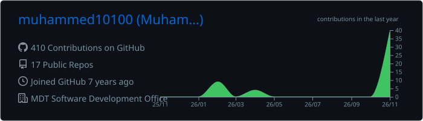
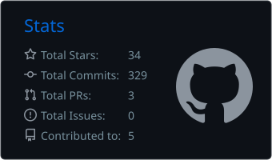
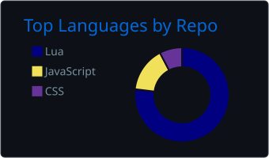
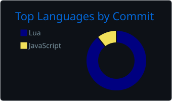
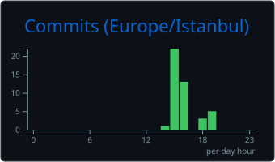
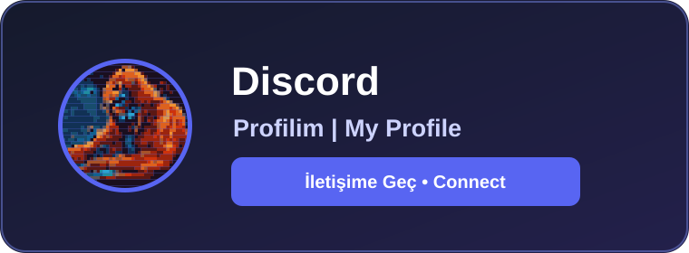

    

<h1 align="center">Muhammed Programmer</h1>

<h3 align="center">[TR] Profilime hoş geldiniz. Umarım sana yardımcı olacak birkaç şey bulursun.</h3>
<h3 align="center">[EN] Welcome to my profile. I hope you find a few things that help you.</h3>

<h3 align="center">[TR] Programlama Dilleri, Araçlar ve Çerçeveler.</h3>
<h3 align="center">[EN] Languages, Tools and Frameworks.</h3>

<h3 align="center">Custom Framework Developer: ESX - QBCORE - QBUS - OX - AI-CORE - VRP - ALTV - GAME DEVELOPMENTS</h3>

<h3 align="center">Languages and Tools:</h3>

    
    
    
    
    
    
    
    
    
     
    
    
    
    
    
    
    
    

 

<!-- Bu kartlar .github/workflows/profile-summary-cards.yml tarafından bu repoda üretilir. -->

    

    
    

    
    

    

<h3 align="center">💬 Discord | İletişim / Contact</h3>

    

    Discord üzerinden ulaşın • Connect with me on Discord

